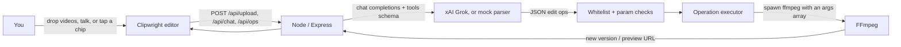

# Clipwright

A Grok-powered video editor. You upload clips, then talk (or type) in plain language — “cut the first 5 seconds”, “trim clip 2 to 10s”, “crop to 9:16” — and Grok drives the edits. Ready-made action chips in the editor map to the same validated operations.

The app name is **Clipwright**. The repository is `grok-video-editor`.

## What it does

- Drag and drop videos onto the stage or the clip list (file picker as a fallback).
- Reorder clips by dragging them in the clip list.
- Preview sources and each saved program version in the player.
- A Grok chat panel is docked in the editor (not a separate page), with quick-action chips: Trim, Cut at playhead, Split, Merge clips, Speed up, Add captions, Fade in/out, Crop to 9:16, Mute, Extract audio.
- Optional microphone button uses the browser’s Web Speech API when the browser supports it, and disables cleanly when it does not.
- Every applied edit is stored as a version you can restore (undo).

## Architecture



How a turn works:

1. The editor sends the recent chat, the playhead time, the selected clip, and the project state to `POST /api/chat`.
2. If `XAI_API_KEY` is set, the server calls the xAI chat completions API (`https://api.x.ai/v1`, OpenAI-compatible) with a tools schema for `apply_edits`. Grok returns structured operations, not shell commands.
3. If the key is missing, a keyword parser (mock mode) produces the same operation objects so the app still runs.
4. The backend validates every op (type whitelist, numeric ranges, safe IDs — never a raw path, never a shell string).
5. The executor maps ops to FFmpeg arguments and runs them with `spawn` (no shell). Outputs land in `storage/outputs` and a new version is recorded.
6. The editor refreshes the preview and the version list.

## Stack

- **Frontend:** Vite + React (drag-and-drop stage, clip list / simple timeline, player, docked chat, version rail).
- **Backend:** Node 20+ and Express. Uploads with multer to `./storage`. Chat and ops routes. Local JSON project store.
- **Editing:** FFmpeg / FFprobe, invoked with argument arrays only.
- **Assistant:** xAI Grok (`XAI_MODEL`, default `grok-4`) or the built-in mock parser.

## Setup

Requirements:

- Node.js 20 or newer
- FFmpeg and FFprobe on your `PATH` (`ffmpeg -version`)
- An xAI API key for real Grok (optional — see mock mode below)

```bash
git clone https://github.com/samsagewize/grok-video-editor.git
cd grok-video-editor
cp .env.example .env
# Edit .env and set XAI_API_KEY to use Grok. Leave it empty for mock mode.
npm install
npm test
npm run smoke
npm run dev
```

Then open [http://localhost:5173](http://localhost:5173). The Vite dev server proxies `/api` and `/media` to the Express app on port 3001.

Production-style run (after `npm run build`):

```bash
NODE_ENV=production npm start
```

The API (and the built client) then listen on `PORT` (default 3001).

### Environment

See `.env.example`. Nothing secret is committed.

| Variable        | Meaning                                                                 |
| --------------- | ----------------------------------------------------------------------- |
| `PORT`          | API port, default `3001`                                                |
| `XAI_API_KEY`   | xAI API key. Empty or unset enables mock mode                           |
| `XAI_MODEL`     | Model name, default `grok-4`                                            |
| `XAI_API_BASE`  | API base, default `https://api.x.ai/v1`                                 |
| `MAX_UPLOAD_MB` | Upload size limit, default `500`                                        |

### Running with real Grok

1. Create an API key in your [xAI](https://console.x.ai/) account.
2. Put it in `.env` as `XAI_API_KEY=...` (never commit that file).
3. Optionally set `XAI_MODEL` if you want something other than `grok-4`.
4. Restart `npm run dev`. The header pill should switch from “Mock assistant” to `Grok · <model>`.

## Supported operations

`trim`, `cut_range`, `split`, `merge`, `speed`, `add_text`, `add_captions`, `fade`, `blur`, `grayscale`, `crop_ratio`, `resize`, `mute`, `extract_audio`, `volume`.

Chips and the mock parser emit these same objects. The executor will not run an unknown type or a path supplied by the model.

## Project layout

```
client/                 Vite + React editor
server/
  index.js              HTTP API
  chat.js               xAI tool loop + mock fallback
  mock-parser.js        Keyword parser for mock mode
  schema.js             Op whitelist, validation, tool schema, chips
  executor.js           Maps ops to FFmpeg args
  run-ffmpeg.js         spawn wrappers + ffprobe
  project.js            Local project + version store
  paths.js              Storage roots and safe IDs
storage/                uploads, outputs, tmp (gitignored contents)
test/                   Node test runner
scripts/smoke-test.js   Generates a testsrc clip and runs a trim
```

## Tests

```bash
npm test          # schema, mock parser, and FFmpeg ops on a generated testsrc clip
npm run smoke     # end-to-end trim through applyEdits
```

## Roadmap

- Multi-select ranges and ripple delete in the clip list
- Waveforms and frame-accurate playhead tools
- Export presets (platform sizes, quality caps)
- Streaming assistant replies
- Optional cloud object storage instead of local `./storage`
- Signed-in projects so more than one edit session can coexist

## License

MIT
